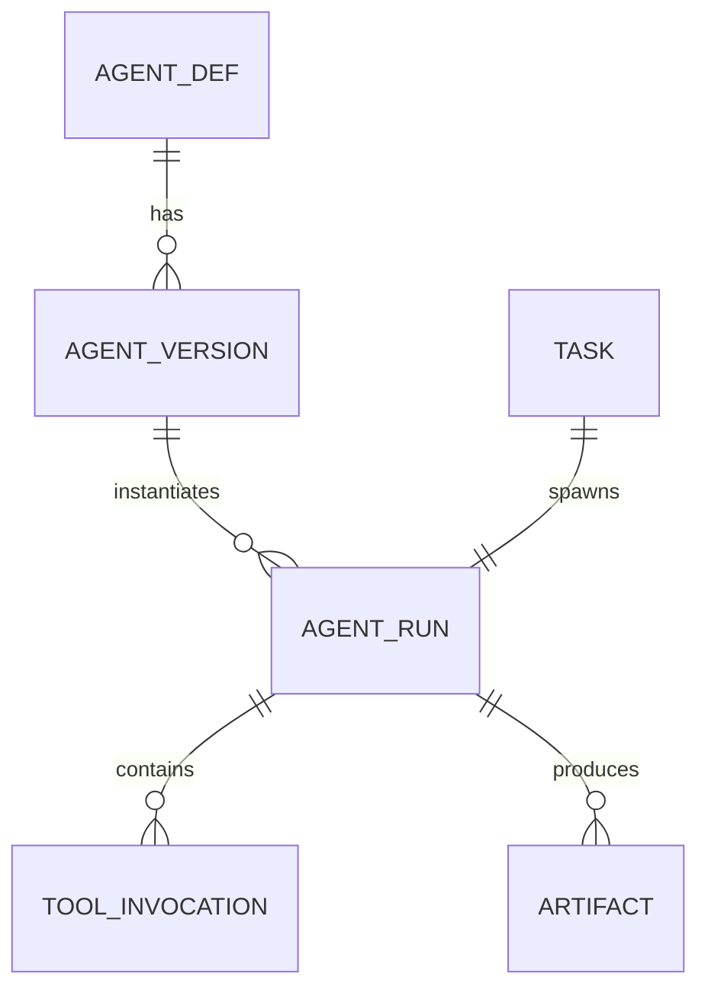
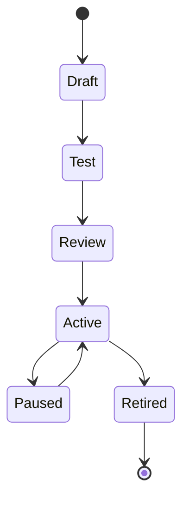
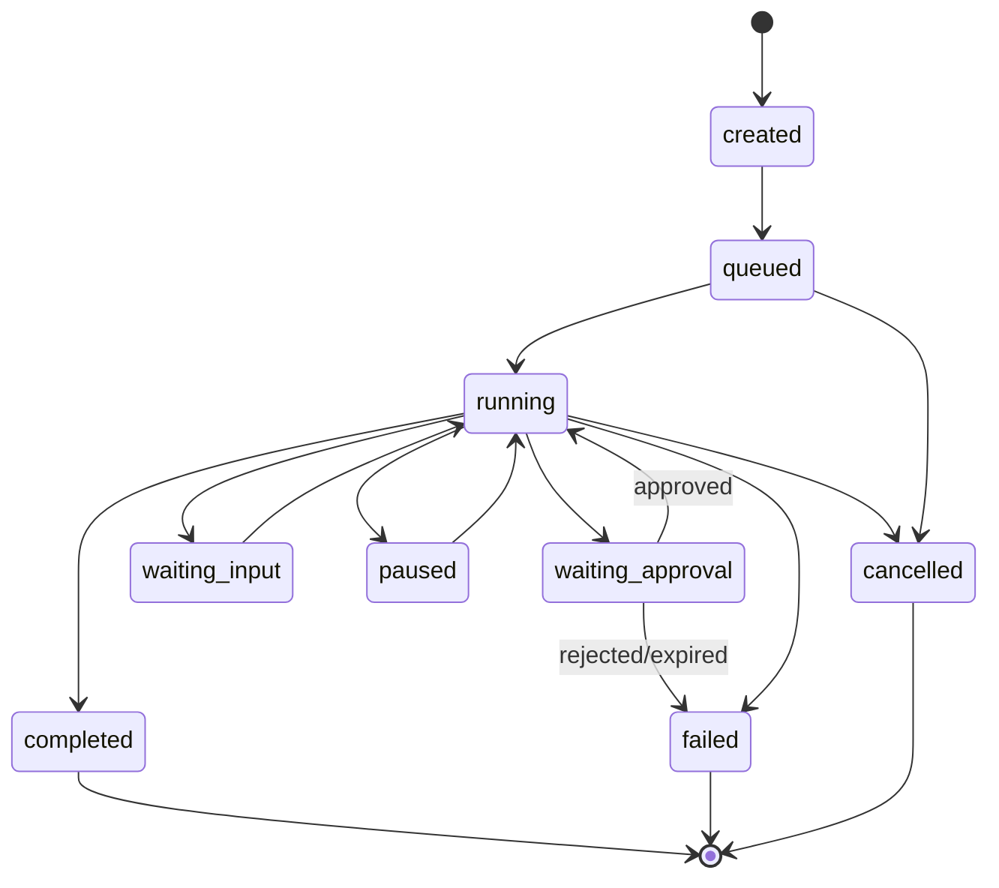

# Agent Platform — Definitions, Lifecycle, Orchestration

## Agent definition (contract)

Immutable after activation (**versioned**); stored as JSON/YAML plus normalized DB rows.

| Field | Description |
|-------|-------------|
| `agent_id` | Stable UUID |
| `name`, `description` | Human-facing |
| `mission` | Outcome-oriented statement |
| `owner_user_id` | Founder (MVP) |
| `version` | Semver or int; **immutable** post-activate |
| `venture_id` / `project_ids` | Scope (null venture = invalid for production agents) |
| `instructions` | System/developer instructions (stored; signed if needed later) |
| `tools` | Allowlisted tool operation IDs + parameter schemas |
| `permitted_operations` | Authority level per operation class (see `SUPERVISED_AUTONOMY.md`) |
| `knowledge_access` | Library IDs, retrieval modes |
| `input_formats` | e.g. JSON schema for task payload |
| `output_schema` | JSON Schema for deliverables |
| `model_config` | Provider, model, temperature caps, max tokens |
| `execution_mode` | sync, async, scheduled, event-driven (MVP: async + manual) |
| `approval_policy_id` | Links to policy rules |
| `budget` | Tokens, USD/month, max run cost |
| `runtime_limits` | Wall clock, step count, tool call count |
| `evaluation_criteria` | Rubric pointers (Phase 2 automated eval) |
| `status` | draft, testing, pending_review, active, paused, retired |

### Definition vs execution

- **Definition** = versioned template (Agent Registry).
- **Execution** = **AgentRun** bound to `task_id`, `agent_version_id`, trace ID, cost lines.

## Lifecycle

| Transition | Rules |
|------------|-------|
| Draft → Test | Minimal validation (schemas, tool refs) |
| Test → Review | Successful sandbox run or checklist (configurable) |
| Review → Active | Founder confirms; version **frozen** |
| Active → Paused | Manual or budget / policy |
| Active → Retired | No new runs; historical retained |

### Upgrades and rollback

- **Upgrade:** create `agent_version+1` from copy of prior; run tests; activate new version. Old version remains addressable for **replay/debug** only.
- **Active runs on old version:** continue on **pinned** version until complete or policy max time; new tasks use new version by default (configurable per project).
- **Rollback:** set “default active version” to previous; does not mutate frozen rows.

## Agent categories (interfaces)

| Category | Typical tools | Approval profile |
|----------|---------------|------------------|
| Knowledge | Search, summarize, extract | Prepare-level default; external crawl restricted |
| Execution | Email, CMS, repo (future) | External / High-impact per op |
| Monitoring | Poll feeds, metrics | Observe/Prepare; External on alerts |

MVP implements **Research** as a **Knowledge**-heavy agent with explicit approval at scope and any external send.

## Task assignment model

1. **Task** created with `assigned_agent_id` (optional) or **workflow step** resolves agent by template.
2. Task Manager enqueues **AgentRun** with idempotency key `hash(task_id + step + intent + version)`.
3. **One accountable agent per task** (MVP). Subtasks are separate tasks with **narrower** scope.

### Future: controlled delegation

- Parent task `T` spawns child task `C` with `delegation_chain` and **max authority = min(parent, child policy)**.
- Child cannot request tools absent from parent envelope.

## Persistent task state machine

States: `created`, `queued`, `running`, `waiting_approval`, `waiting_input`, `paused`, `completed`, `failed`, `cancelled`.

### Reliability mechanics

| Mechanism | Behavior |
|-----------|----------|
| Lease + heartbeat | Worker holds lease; stale lease → requeue |
| Retry | Classify error: transient vs terminal; backoff + jitter |
| Deadline | `deadline_at`; transition to `failed` with reason |
| Cancellation | Cooperative: signal run; kill lease; idempotent cleanup |
| Idempotency | External effects keyed by `idempotency_key` in Tool Gateway |

## Orchestration components (mapping)

| # | Component | Role |
|---|-----------|------|
| 1 | Agent Registry | Definitions/versions |
| 2 | Task Manager | State machine + queue |
| 3 | Workflow Coordinator | Templates and runs |
| 4 | Execution Runtime | LLM + tool loop |
| 5 | Tool Gateway | Enforce allowlists and secrets |
| 6 | Permission Engine | Pre-call check |
| 7 | Approval Service | Gate on risk class |
| 8 | Knowledge Retrieval | Retrieval with citations |
| 9 | Artifact Storage | Blobs + metadata |
| 10 | Audit/Observability | Events, traces, cost |

## Observability

- **Trace:** OpenTelemetry spans per run (task, model call, tool call).
- **Cost:** Per-call token usage → rollup to venture/month.
- **Evaluation hooks:** store offline labels in Phase 2.

## Related documents

- `SUPERVISED_AUTONOMY.md` — Authority and approvals.
- `DATA_MODEL.md` — Tables.
