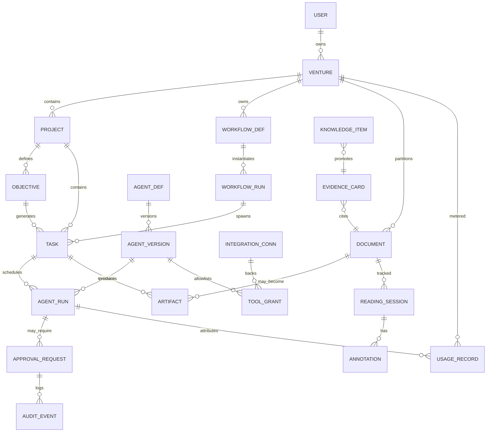

# Logical Data Model — Titanium Founder OS

## Multi-venture isolation

Each **venture** is the primary **security and knowledge boundary**.

| Isolated per venture | Mechanism |
|----------------------|-----------|
| Documents and research | `venture_id` on every row + object storage prefix |
| Projects and objectives | FK to `venture` |
| Agent permissions | `agent_def.venture_id`; tool grants cannot exceed venture integration scopes |
| External integrations | `integration_connection` rows scoped; secrets in Secret Manager namespaced |
| Knowledge collections | Default library = venture; project is sub-scope |
| Files and sensitive blobs | Bucket prefix + signed URL policy |
| Reports and decision history | RLS policy tied to `venture_id` |

**Shared knowledge across ventures** requires an explicit `cross_venture_grant` record (who, what, expiry, audit). Default is deny.

## Entity relationship (core)

## Key entities (logical)

| Entity | Purpose | Ownership / scope |
|--------|---------|-------------------|
| `user` | Founder (MVP) | Global identity |
| `venture` | Business or initiative boundary | `owner_id` |
| `project` | Initiative within venture | FK venture |
| `objective` | Measurable goal | FK project |
| `task` | Actionable unit with state machine | FK project + optional objective |
| `workflow_def` | Template graph | FK venture |
| `workflow_run` | Instance | FK workflow_def + project context |
| `agent_def` | Logical agent | FK venture |
| `agent_version` | Immutable definition snapshot | FK agent_def |
| `agent_run` | Execution instance | FK task + agent_version |
| `integration_connection` | OAuth/API secrets reference | FK venture; secret ref only |
| `tool_grant` | Allow op IDs per agent_version | Narrow union |
| `approval_request` | Gate for external/high-impact | FK agent_run + task |
| `artifact` | Blob or JSON deliverable | FK venture + project |
| `document` | Knowledge document | FK venture; optional project |
| `reading_session` | Human reading state | FK document + user |
| `annotation` | Highlights/notes | FK reading_session |
| `evidence_card` | Structured research evidence | FK document(s); project library |
| `knowledge_item` | Searchable indexed item | Typed; FK venture/project |
| `audit_event` | Append-only | Immutable fields |
| `usage_record` | Cost/tokens/API units | FK venture; optional agent_run |
| `cross_venture_grant` | Explicit share | Rare |

## State fields (representative)

| Entity | Field | Notes |
|--------|-------|------|
| `task` | `status` | state machine (see `AGENT_PLATFORM.md`) |
| `agent_version` | `status` | draft/test/review/active/retired |
| `approval_request` | `status` | pending/approved/rejected/expired/revoked |
| `document` | `reading_status` | Not a substitute for human completion flag on session |

## MVP vs deferred

### MVP (minimum tables/records)

- `user`, `venture`, `project`, `objective`, `task`
- `agent_def`, `agent_version`, `agent_run`
- `integration_connection`, `tool_grant`
- `approval_request`, `audit_event`
- `document`, `reading_session`, `annotation`
- `evidence_card`, `knowledge_item` (simplified)
- `artifact`, `usage_record`
- `workflow_def` / `workflow_run` **if** research pipeline is modeled as workflow; else defer to **single task** with sub-steps in JSON and add tables in Phase 2

### Deferred

- Rich `delegation` graph tables beyond simple `parent_task_id`
- Automated evaluation suite tables
- Fine-grained `policy_rule` versioning beyond a single JSON document

## JSON documents (acceptable MVP pattern)

- `agent_version.config` — single JSON column validated by JSON Schema in API.
- `task.payload` / `agent_run.trace_ref` — pointer to object storage for heavy traces.

## Referential integrity rules

- Every `agent_run` **must** have `venture_id` denormalized or joinable via `task` for RLS performance.
- `approval_request.parameters_hash` immutable; new params → new row.

## Related documents

- `SYSTEM_ARCHITECTURE.md` — Service boundaries.
- `SECURITY_THREAT_MODEL.md` — RLS expectations.
