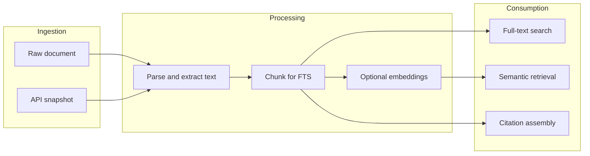

# Knowledge Architecture — Provenance, Storage, Retrieval

## Knowledge types (non-interchangeable)

| Type | Description | Trust model |
|------|-------------|-------------|
| Raw document | Uploaded PDF, note export | Trusted as **artifact**; not yet “read” by human |
| Retrieved source | API snapshot (e.g. OpenAlex work metadata) | Trusted as **metadata** subject to provider correctness |
| Verified fact | Founder- or process-verified statement | Linked to sources and verification record |
| AI interpretation | Model synthesis | **Never** displayed as fact without label |
| Founder note | Human note | Authoritative for intent, not external truth |
| Hypothesis | Untested belief | Tagged `hypothesis` |
| Decision | Approved choice | Immutable versions |
| Deliverable | Agent output | Versioned; may be draft vs approved |



## Storage layers

| Layer | Content | Notes |
|-------|---------|-------|
| Object storage | Original files (PDF) | Venture-prefixed keys; server-side encryption |
| Postgres | Metadata, permissions, status, hashes | RLS by `venture_id` |
| Search index | FTS (Postgres `tsvector` or managed search) | MVP: Postgres FTS acceptable |
| Vector store (optional) | Embeddings | Same venture partition; can be pgvector |

## Metadata (minimum)

- `venture_id`, `project_id[]`, `title`, `authors`, `source_url`, `doi`, `publication_date`, `ingest_source`, `sha256`, `classification`, `provenance_chain`, `retention_policy_id`, `created_by`, `verification_status`.

## Document ingestion

1. **Upload** or **API fetch** (metadata only for paid content).
2. **ClamAV / malware scan** (design requirement; implementation TBD).
3. **Text extraction** (pdfminer/pdf.js server-side); store extracted text separately with hash.
4. **PII scan** optional flag for compliance (defer rules to policy).

## Full-text and semantic

- **FTS:** Required MVP; highlights point to character offsets into extracted text store.
- **Semantic:** Optional; results must show **similarity score** and **never** hide the source chunk.

## Citations

Evidence citations reference:

- `document_id`, `page` (PDF page), optional `bbox`, **quoted span** with checksum.

## Project-scoped context

- Default search: **current project + venture library**.
- “Include personal founder notes” toggle (still venture-scoped).

## Versioning

- **Documents:** new upload → new version row; previous kept.
- **Evidence cards:** immutable versions; edits create v2.

## Provenance and non-claims

UI and API must expose:

```text
interpretation | draft | verified | hypothesis | decision
```

Downstream agents **must** consume structured labels, not prose markers only.

## Data retention and export

| Policy | MVP |
|--------|-----|
| Export | ZIP of PDFs + JSON metadata per venture |
| Deletion | Tombstone with audit; purge object storage per policy |
| Model training | **Opt-in**; default off |

## MVP complexity guardrail

Avoid general-purpose knowledge graphs. Use **typed links**: `supports`, `contradicts`, `related_work`, `cites` as simple edges table for later expansion.

## Related documents

- `RESEARCH_AGENT_SPEC.md` — Research-specific funnel.
- `DATA_MODEL.md` — Tables.
