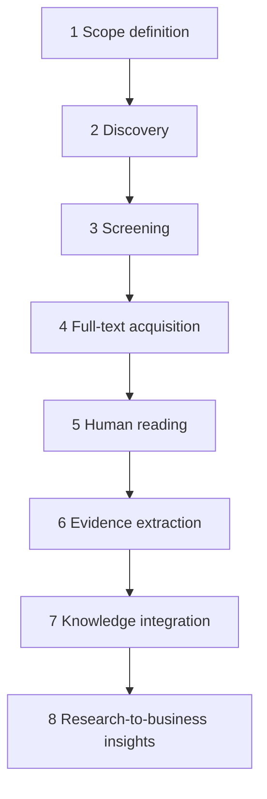

# Research Agent — End-to-End Specification

## Mission

Eliminate tedious **research administration** while keeping the founder responsible for **reading and critiquing original sources**.

## Personas

- **Founder:** Approves scope, reads PDFs, verifies evidence.
- **Research Agent:** Structures the workflow, discovers and screens literature, proposes cards — **does not** mark items “personally read”.

## Workflow overview

---

### Stage 1 — Define the research question

**Goal:** Translate objective into structured scope.

**Outputs:**

- Search queries (Boolean + fielded where supported)
- Related terminology
- Research subquestions
- Inclusion / exclusion criteria
- Relevant disciplines

**Gate:** **Founder approval** (Approval Service) required before any bulk discovery spend.

**Authority:** L2 Prepare until approval; discovery triggers queued as **pending** until approved.

---

### Stage 2 — Scholarly discovery

**Goal:** Populate candidate pool from open scholarly indexes.

| Provider | Typical use | API / access notes |
|----------|-------------|-------------------|
| OpenAlex | Broad discovery, open metadata | Public API; rate limits — **verify current ToS/limits** |
| Crossref | DOI metadata | Public API; **verify** politeness and rate limits |
| Unpaywall | OA URL hints | API key; **verify** usage rules |
| PubMed / NCBI E-utilities | Biomedical | Public; **verify** key requirements for high volume |
| JSTOR | Abstracts or institutional metadata | **Requires verification** — likely no general open full text |
| Google Scholar | Discovery links | **Scraping prohibited**; treat as manual / export workflows only |

**Architecture:** Tool Gateway adapters per provider; **venture-scoped API keys**; centralized rate limiting and cost accounting (API units, not LLM tokens).

**Requirement:** Record **full request/response provenance** (redacted keys) for audit.

---

### Stage 3 — Screening

**Goal:** Dedupe and rank relevance with transparent reasons.

**Functions:**

- Deduplicate by DOI, ISBN, or normalized title+year+author.
- Classify publication type (article, review, book, etc.).
- Score relevance with **explainable** features (not black box only); store **screening decision log**.
- Preserve **excluded** items with reason codes for founder review.

**Outputs:** `screening_log` rows + `candidate` shortlist.

---

### Stage 4 — Full-text acquisition

**Rules:**

- Use **authorized** OA links or founder-provided files only.
- **Do not** attempt paywall bypass or credential stuffing.
- Support **manual PDF upload** per paper.

**Outputs:** `document` records pointing to object storage; linkage to metadata.

---

### Stage 5 — Human reading (PDF reader)

**Requirements:**

- Page navigation, full-text search within document, highlights, annotations, bookmarks, personal notes.
- Reading progress per user.
- **Prohibition:** Automated “mark as read for founder” — completion is explicit human action.

**States:** `queued` → `in_progress` → `completed_by_human` (explicit).

---

### Stage 6 — Evidence extraction

**Evidence card** fields:

| Field | Required |
|-------|----------|
| Source document | Yes |
| DOI | If available |
| Page / location | Yes for quotes |
| Quoted passage | Yes |
| Findings | Yes |
| Methodology | If applicable |
| Limitations | Encouraged |
| Personal interpretation | Optional; labeled |
| Verification status | `unverified` default until founder confirms |

---

### Stage 7 — Knowledge integration

- Cards join **project library** with citations.
- Support “related work” edges for later comparison (simple graph).

---

### Stage 8 — Research-to-business insights

- Agent may produce **hypothesis** and **product opportunity** drafts.
- Must carry **`speculative`** and **`non_empirical`** flags when not directly supported by verified cards.
- Example: community–scam vulnerability research → programming ideas for Titanium Connect **without** claiming proven efficacy.

## Failure and escalation

| Failure | Behavior |
|---------|----------|
| API rate limit | Backoff; surface task `waiting` with reason |
| Provider outage | Switch to alternate provider if configured |
| Ambiguous relevance | Founder queue “resolve” tasks |

## MVP scope vs later

- **MVP:** OpenAlex + Crossref + manual PDF + Postgres FTS; Unpaywall if key available.
- **Later:** PubMed specialization, institution SSO for licensed PDFs (legal), automated monitoring agents.

## Related documents

- `KNOWLEDGE_ARCHITECTURE.md` — Storage and provenance.
- `AGENT_PLATFORM.md` — Runs and task states.
