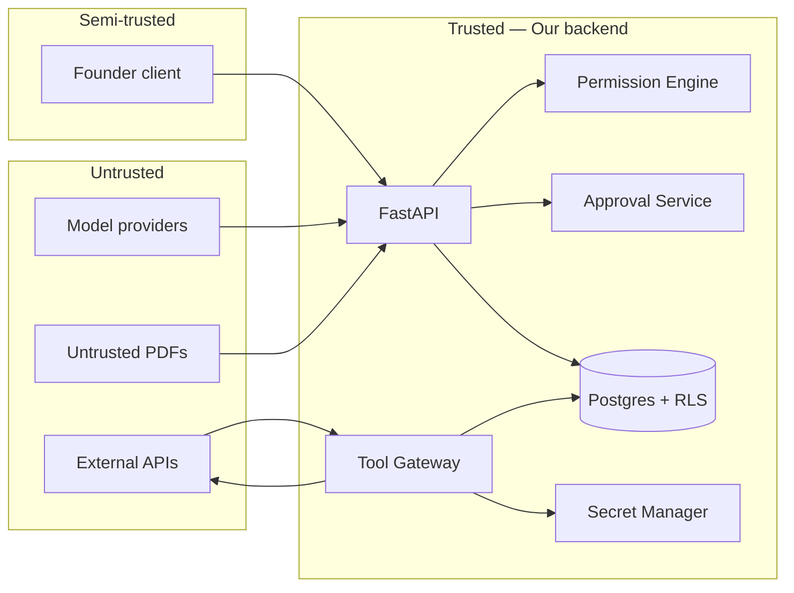

# Security Threat Model — Titanium Founder OS

## Premises

- **Privileged internal app** for a founder; still high value (secrets, strategy, customer-related notes).
- **No verified implementation** exists in this repository yet — treat controls as **design requirements** until built and tested.
- **Isolation** from Titanium Guardian production is a **hard requirement** for architecture (separate DB/project/service account).

## Trust boundaries

## Assets

| Asset | Impact if compromised |
|-------|----------------------|
| Integration tokens / SMTP / APIs | Abusive sends, data exfiltration |
| Strategy documents | Competitive harm |
| Research / evidence | Wrong business decisions |
| Founder identity | Full account takeover |
| Model traces | Prompt leakage, PII in logs |

## Threats and mitigations

| Threat | Description | Mitigation (design) | Residual risk |
|--------|-------------|---------------------|---------------|
| T1 Prompt injection via tool outputs | Malicious content steers agent to exfiltrate | Tool allowlists, arg typing, egress proxy, strip HTML from untrusted fetches | Requires ongoing tuning |
| T2 Cross-venture data access via confused deputy | Task mis-scoped to wrong `venture_id` | Mandatory RLS; server-side scope on every query | Misconfigured policy bugs |
| T3 Unauthorized external action | Model “chooses” to send email | Approval Service + deterministic policy | Misclassification of op severity |
| T4 Duplicate external effects | Retries double-send | Idempotency keys in Tool Gateway | Provider non-idempotent APIs |
| T5 Secret leakage via logs | Tokens in stdout | Log scrubbers; structured logging | Human error |
| T6 Malicious PDF | Exploit in parser | Sandbox parsing; ClamAV; size limits | Zero-days |
| T7 Insider misconfig | Overbroad tool grants | Review step before activate; audit | Social |
| T8 Staging/prod bleed | Wrong DB URL | Separate projects; infra checks | Ops mistakes |
| T9 Agent self-elevation | Crafted tool call | No self-mod endpoints; PE denies | Implementation gaps |

## Founder-only authentication (MVP)

- Options: Supabase Auth with **allowlist** of one user; or SSO later.
- **Enforcement:** JWT validated server-side; **never** trust client claims for RLS alone — use `auth.uid()` in policies.

## Server-side authorization pattern (RLS exemplar)

- Tables carry `venture_id`.
- Policies: `venture_id in (select user_allowed_ventures(auth.uid()))`.
- **Founder MVP:** allowed_ventures = all owned ventures.

## Encryption

- At rest: cloud-managed encryption for DB and object storage.
- In transit: TLS everywhere.

## Audit

- Append-only `audit_event` with hash chain optional later.
- Security-relevant: approvals, policy edits, agent activation, integration create/rotate.

## Rate limits and cost caps

- Per integration in Tool Gateway.
- Per agent monthly budget; hard stop → `paused`.

## Emergency stop

- See `SUPERVISED_AUTONOMY.md` — kill switch must revoke tokens and block queue dispatch centrally.

## What is **not** yet implemented

- **Everything** in this repo at design time: no code, no tests, no production controls.

## Unresolved security decisions (open)

1. **PDF engine** choice (native vs WASM) and sandbox boundary.
2. **Provider logging** — whether to use zero-retention where available.
3. **SIEM** integration for founder solo org (possibly deferred).

## Related documents

- `ARCHITECTURE_DECISIONS.md` — Decisions log.
- `SUPERVISED_AUTONOMY.md` — Policy lifecycle.
