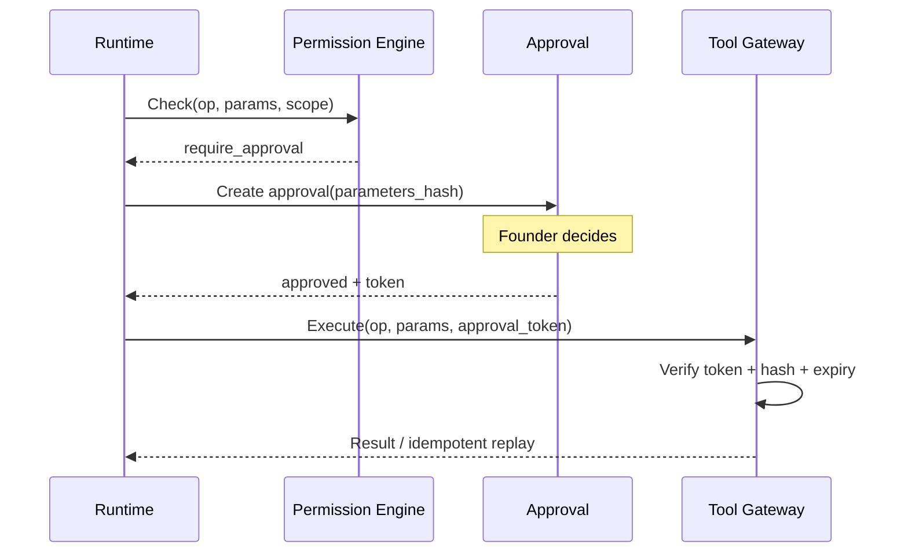

# Supervised Autonomy — Permissions, Approvals, Policy

## Authority levels (defaults)

| Level | Name | Typical operations | Default agent posture |
|-------|------|-------------------|------------------------|
| L1 | Observe | Read authorized APIs, search indexes, metrics | Allowed without approval if source whitelisted |
| L2 | Prepare | Drafts, summaries, internal notes, structured extractions | Allowed; stored as `interpretation` or `draft` |
| L3 | External | Send email, post content, update external records | **Approval required** (deterministic) |
| L4 | High-impact | Production change, financial commit, permission change, destructive ops | **Approval required** + stricter reviewer routing |

**Important:** Levels are **not** a substitute for contextual risk scoring. Policy may elevate an L2 operation to L3 based on target, size, or content class.

## Policy engine (deterministic)

- **Inputs:** user role (founder MVP), venture/project scope, agent version, tool operation, resource target, parameter hash, budgets, content class (if applicable).
- **Output:** `allow | deny | require_approval | require_review` with `policy_rule_id` trace.
- **Implementation:** server-side in **Permission Engine** + **Approval Service**; model output cannot override.

### Prohibition

Agents **must not** be able to:

- Self-grant tools or widen scope.
- Approve their own requests.
- Exfiltrate data from Venture A while task is scoped to Venture B.

Enforced via:

- Tool Gateway rejects unknown operations.
- Row-level scope checks on every artifact write.
- No “prompted” elevation path in API.

## Approval request object

| Field | Description |
|-------|-------------|
| `approval_id` | UUID |
| `requesting_agent_id` / `agent_version` | Source |
| `task_id` / `workflow_run_id` | Lineage |
| `operation` | Canonical op ID (e.g. `email.send`, `cms.publish`) |
| `target_service` | Registered integration |
| `resource_ref` | External resource identifier |
| `parameters_exact` | Canonical JSON (material fields only) + hash |
| `parameters_redacted` | Human view for UI |
| `explanation` | Agent rationale (non-authoritative) |
| `risk_class` | `low|medium|high|critical` |
| `impact` | Summary + blast radius estimate |
| `reversibility` | `reversible|partial|irreversible` |
| `expires_at` | Short TTL; stale → must recreate |
| `reviewer_user_id` | MVP: founder |
| `status` | `pending|approved|rejected|expired|revoked` |
| `audit` | Append-only decision log |

### Exact parameters

Approval binds to **`parameters_hash`**. If parameters change meaningfully, status → `superseded` and a **new** approval is required.

### States

| State | Meaning |
|-------|---------|
| Pending | Awaiting decision before tool execution |
| Approved | Tool may execute until `expires_at` |
| Rejected | Terminal; task moves to `failed` or `waiting_input` per policy |
| Expired | No execution; user must re-approve |
| Revoked | Previously approved but invalidated (incident, scope change) |

## Action lifecycle (external)

## Idempotency and duplicate prevention

- Tool Gateway stores **`idempotency_key`** = `hash(approval_id + op + params_hash)` for mutating external calls.
- Replays return same result record; no double-send.

## Emergency stop

| Control | Effect |
|---------|--------|
| Agent pause | No new runs; in-flight may finish or cancel per policy |
| Global kill switch | All agents paused; integrations disabled |
| Integration revoke | Tokens invalidated at gateway |

Implement centrally in **Agent Registry** + **Tool Gateway** (not UI-only).

## Prompt injection and excessive authority (mitigations)

| Risk | Mitigation |
|------|------------|
| Tool instruction injection | Tools receive **structured** args; reject free-text where possible; sanitize HTML/email bodies separately |
| Confused deputy | Tool Gateway checks **venture/project** on every call |
| Data exfil via “summarize” | Retrieval scoped; export actions are L3+ |
| Model requests forbidden op | Permission Engine denies; no bypass from “please ignore rules” text |

## Cross-venture safeguards

- Tasks carry `venture_id`; all reads/writes include it in queries.
- Knowledge links require explicit `cross_venture_grant` record to join corpora.

## Related documents

- `SECURITY_THREAT_MODEL.md` — Threats and residual risk.
- `AGENT_PLATFORM.md` — State machine and runtime.
