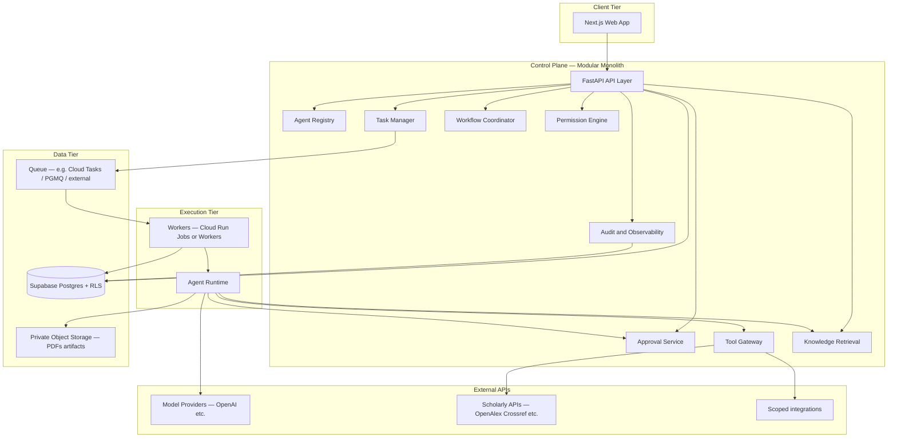
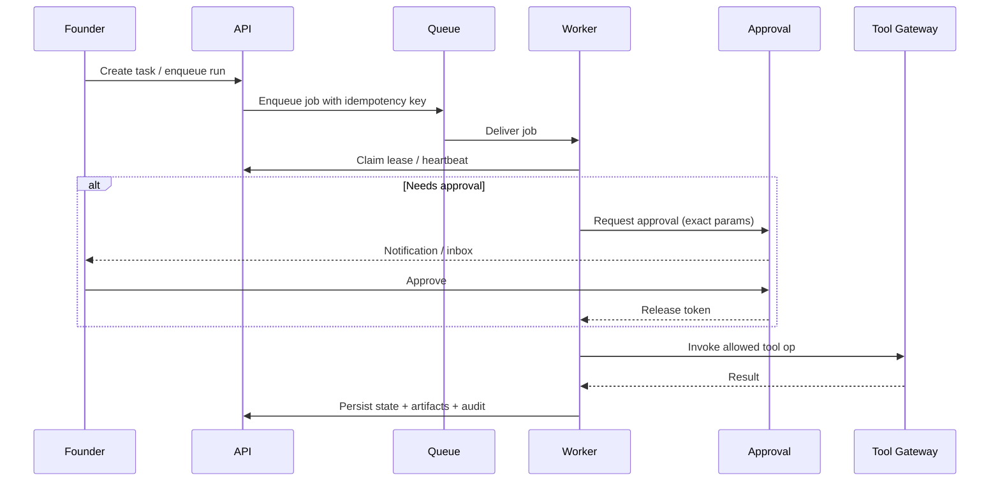

# System Architecture — Titanium Founder OS

## Repository audit (actual)

The current **Founder-OS** workspace contains **only `.git`** with **no commits and no source files**. Therefore:

- **Confirmed in this repo:** nothing beyond version control initialization.
- **Unknown (requires verification in Titanium Guardian / other repos):** Next.js layout, FastAPI modules, Supabase schemas, Cloud Run services, Secret Manager usage, CI/CD, OpenAI wiring, communication integrations.

All diagrams below describe the **target** architecture. Reuse claims must be validated when implementation connects to existing codebases.

## High-level context

## Recommended deployment topology

| Component | Suggested hosting | Rationale |
|-----------|-------------------|-----------|
| Web | Vercel or Cloud Run | Team preference; isolate from Guardian prod |
| API (control plane) | Cloud Run service | Single deploy unit for MVP |
| Workers | Cloud Run Jobs / second service | CPU-heavy PDF, batch discovery |
| Database | Supabase Postgres | RLS for venture isolation |
| Queue | Managed queue + DLQ | Durability, retries, visibility timeout |
| Secrets | Google Secret Manager | Scoped service accounts per env |
| Storage | GCS or Supabase Storage | PDFs and blobs with venture prefix |

## Logical isolation from Titanium Guardian

**Goal:** Reuse **patterns and libraries** (auth helpers, UI kit) without granting Founder OS **network or database access** to Guardian production.

| Approach | Security | Productivity | Recommendation |
|----------|----------|--------------|----------------|
| Same monorepo, separate app + DB + GCP project | High if enforced | High | **Preferred** when tooling is shared |
| Same repo, shared packages only | High | Medium | Good for `@founder/contracts` style packages |
| Separate repo | Highest isolation | Lower reuse friction | Acceptable if release coordination is heavy |

**Direction:** Logically isolated **Founder OS** app (own Supabase project or at minimum separate Postgres schema + separate service accounts + no shared RLS policies with Guardian prod data).

## Control-plane responsibilities (bounded context)

| Module | Responsibility |
|--------|----------------|
| Agent Registry | Definitions, versions, immutability, status |
| Task Manager | State machine, leases, cancellation, retries |
| Workflow Coordinator | DAG/step templates, triggers, run linking |
| Execution Runtime | Invokes models, applies tool policies, emits traces |
| Tool Gateway | OAuth/API keys behind interfaces; operation allowlists |
| Permission Engine | RBAC + venture scope + tool scopes (deterministic) |
| Approval Service | Create/resolve requests; gate tool execution |
| Knowledge Retrieval | Query + citation assembly |
| Artifact Storage | Blob pointers, checksums, venture keys |
| Audit/Observability | Append-only events, metrics, cost lines |

## Event-driven execution (recommended)

## Technology reuse (hypotheses — verify)

| Technology | Likely reuse | Founder OS note |
|------------|--------------|-----------------|
| Next.js | App router UI | New routes under `/founder` or separate deployment |
| FastAPI | JSON API | New `founder_os` package boundary |
| Supabase | Auth + Postgres + RLS | **Separate project recommended** for prod isolation |
| Cloud Run | Stateless services | Dedicated service account |
| Secret Manager | Integration secrets | Per-integration secret IDs in DB, not values |
| OpenAI | LLM calls | Provider abstraction in runtime |

## Framework notes (evaluation, not prescription)

- **Workflow:** Temporal, Inngest, Windmill, or Cloud Tasks + DB state machine. For MVP, **DB-backed state machine + queue** minimizes moving parts; graduate to Temporal if orchestration complexity grows.
- **OpenAI Agents SDK:** Useful for **agent loop and tracing** if it fits provider abstraction; **approval gates** must remain in **your** FastAPI services, not only in SDK callbacks.

## Staging vs production

- Separate Supabase projects (or separate schemas + strict network rules).
- Separate GCP projects or至少 separate Secret Manager secrets and service accounts.
- No shared object buckets between Founder OS staging/prod and Guardian prod.

## Related documents

- `AGENT_PLATFORM.md` — Runtime and task model.
- `ARCHITECTURE_DECISIONS.md` — ADRs and open questions.
